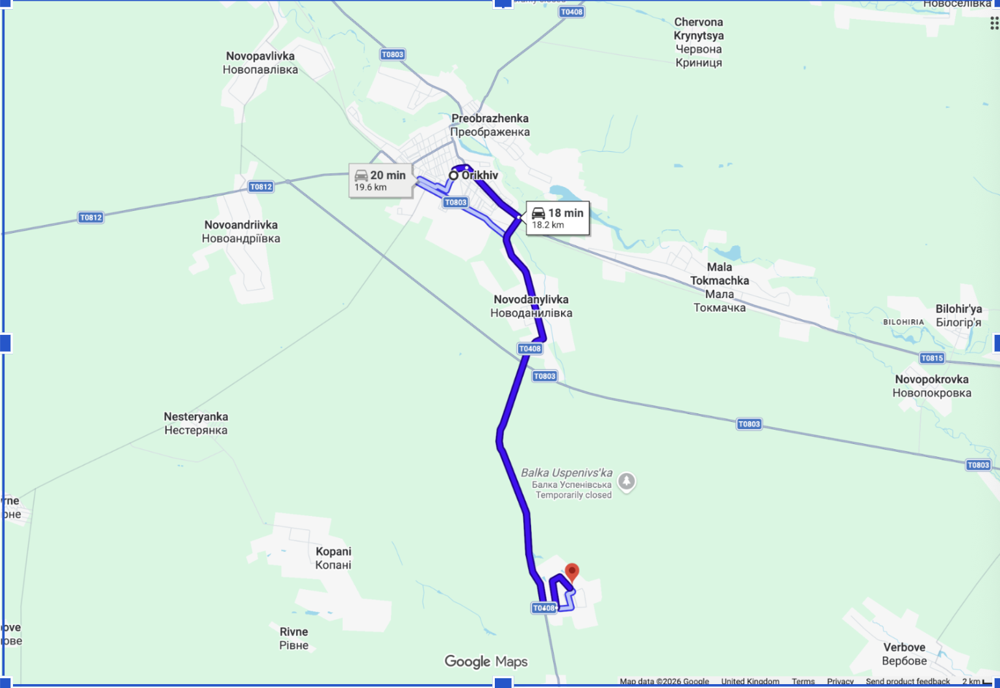
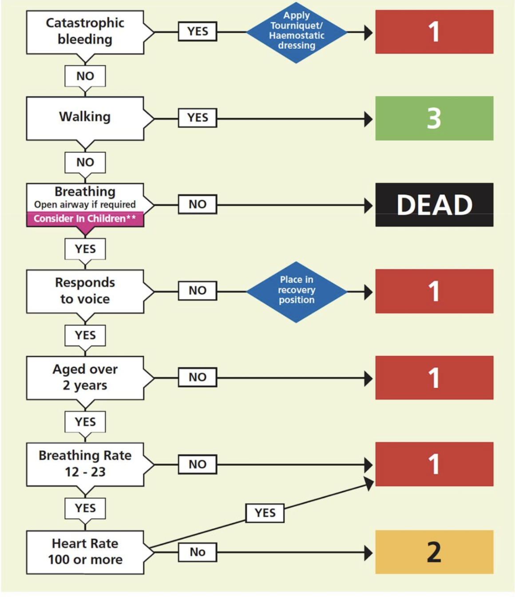

# The Golden Hours: System Design

Team document, EDTH London (2–4 Oct 2026). **This is the single source of truth**: what we build, what is decided, what
is still open, and the plan. If code and this document disagree, fix one of them the same day. A decision taken while
coding goes into section 6 or 7 before the code is pushed.

---

## 1. The problem

Getting wounded troops to surgery within an hour nearly halved combat deaths in Afghanistan (13.7% → 7.6%). That "golden hour" depended on fast evacuation through uncontested airspace.

Cheap drones have ended that. In Ukraine, casualties are held forward for hours, days or even weeks, evacuated in brief windows by ground robots or on foot, and kept alive by supplies pushed forward to them.

The physiology hasn't changed, but the logistics have. Evacuation is no longer one fast transfer: it is a continuous coordination problem across casualties, routes, windows, assets and resupply. Commanders lack a single live picture of these relationships, so they can't prioritise who moves, when, by what means, and what must reach them first.

**Who is the user or stakeholder?** The C2 (command and control) of a medical brigade, and ambulance coordinators.

**Does this actually work in the real world?** Maybe. To validate with mentors.

**Is it novel, useful and mass-producible?** Yes.

**Dual use.** The same system applies to organising ambulance services, disaster rescue and civilian mass-casualty events.

### Current trauma pathway

```
Point of wounding
      ↓
Stabilisation / triage point
      ↓
Role 1
      ↓
Role 2 / Role 2 enhanced
      ↓
Field hospital
      ↓
Hospital at home
```

- The number of points at each level is a funnel: there are more stabilisation points than Role 1s, and so on.
- Distance from the frontline increases as you go down.
- So does the seniority of the staff, from a soldier with basic first-aid training to a consultant.

---

## 2. Scenario area

Orikhiv–Robotyne–Zaporizhzhia, Zaporizhzhia oblast (Ukraine), box 47.40–47.90 N, 35.00–35.95 E, using OpenStreetMap
roads. Minor roads and tracks are included only near the front (47.40–47.62 N, 35.60–35.95 E). Main roads in view:
T0408, T0803, T0812, T0815. Scenario time: September 2023 (Robotyne). The front line is at about 47.436 N.

The roads are today's OpenStreetMap (2026), not the 2023 network: they reflect the area as the war has left it
(damaged, rebuilt and newly mapped roads and bridges). This works in our favour: the scenario plays on the terrain
as it is now.



---

## 3. System requirements

### What the system does

1. **Casualties arrive with their information already collected,** as a MIST/MISTAT report or with what is needed
   for a triage decision. Drones and sensors come later. Starting point: there are X casualties with this information.
2. **The medic decides only clinical matters:** triage category and mobility (walking or stretcher), from the report.
3. **The system decides all logistics:** which vehicle goes, the pickup order, which medical point and which route.
   If nothing can take a casualty, it says so ("no resource available").
4. **The system handles changing events,** for example a bridge collapse, or a stabilisation point that is overwhelmed
   or has lost power.
5. **Information arrives asynchronously.** Different messages arrive at different times, and the plan updates from
   each one.
6. **The database tells each UGV where to go next.**
7. **Replay to learn from deployments.** Replaying TuringDB history answers questions such as "if we had one more UGV,
   how many more lives could we have saved?"
8. **Everything is live on a map:** casualties, vehicles, medical points, threats and routes.

### Nice to have

1. **Real detections from drones and devices.** Use a vision model on drone images instead of simulated detections, and gather as much information as possible from drones or electronic devices (such as phones) to feed triage. *Now planned: sensor fusion (section 5, "Sensor fusion"); the vision model is task A2f.*
2. **Request more resources.** When UGVs or medics are short, send a message or call to one of us, simulating getting more UGVs ready as soon as possible.
3. **Plain-language questions** to a local LLM, translated into graph queries.
4. **A triage suggestion,** possibly based on the NHS Major Incident Triage Tool (below). It only suggests; the medic decides. *Now planned: a recommendation from the TCCC doctrine graph (6.13).*



### Out of scope (deliberately)

- **AI that decides clinical priority.** The system *recommends* a triage category from published doctrine rules
  (TCCC, 6.13), with its reasons; the medical coordinator accepts or changes it. The system never sets it alone, and
  no machine-learned model decides a category.
- **Real patient data.** The scenario is synthetic.
- **Anything that could work as targeting or weapons guidance.** This is casualty care only.
- **Cloud services.** Everything runs on our laptops, offline, as it would in the field.

---

## 4. How it works

```
 OSM roads ──build_roads.py──▶ parquet ──LOAD PARQUET──▶ TuringDB graph ◀── seed_scenario.py (points, vehicles,
                                                          ▲   │                     untriaged casualties, Clock)
                          one commit per scenario minute  │   │ reads Clock, SimControl, roads, missions
                                                          │   ▼
                                                     simulate.py: dispatch (routing.py) + movement
                                                          ▲
              triage, play/pause, speed, reset (writes)   │   reads the graph each tick
                                                     C2 screen (visualizer/, /c2)
```

- **TuringDB** holds the state of the world and its history. Every change (a triage, a mission, a tick, a closed
  bridge) is a commit, so time travel, branches and replay come for free.
- **We play the medics.** On the C2 screen we read each casualty's MIST report and set its category and mobility.
  That is the only decision the user takes.
- **The simulator does the logistics and the time** (`scripts/simulate.py`, started by `run.sh`). Each tick is one
  scenario minute and one commit: it dispatches free vehicles to triaged casualties (most urgent first), moves
  vehicles along their routes, picks casualties up, drops them off, and moves the clock on.
- **Everything hangs off the road network.** Casualties, vehicles and medical points link to their nearest junction
  with `NEAR`. A route is a path of `ROAD` edges between those junctions.
- **Everything that happens during a run is an `Event`** (6.11): a closed bridge, a new casualty, a drone or radio
  observation, more UGVs. The demo script, buttons and the radio create events; the simulator applies them on the
  tick.
- **Sensor fusion feeds a triage recommendation** (section 5, "Sensor fusion"). Drones and the soldier's triage app (radio
  reports later) become `Observation`s of doctrine findings ("bleeding badly?") with a confidence. Fusion decides
  which findings are present; the doctrine graph (Noo's, from the TCCC handbook) turns them into a recommended
  category with its reasons. The medical coordinator accepts or changes it.
- **A mission** is vehicle → casualty → medical point. A UGV drops at a handover or collection point; the casualty
  then waits for an ambulance to Role 1 or higher (the second leg).

---

## 5. Data model

Status: ✅ in the graph today · 🔜 decided, not built yet · ❓ depends on an open decision (section 7).

### Entities

```
(:Junction {id, lat, lon})                                                         ✅

(:MedicalPoint {id, name, lat, lon, type, capabilities, medics_available,          ✅
                state, free_beds,
                medics_total})                                                     🔜

(:Vehicle {id, type, lat, lon, litter_capacity, ambulatory_capacity, range_km,     ✅
           battery_pct, max_threat, speed_kmh, status})

(:Casualty {id, lat, lon, time_of_injury, status, triage_category, mobility,       ✅
            mist_mechanism, mist_injuries, mist_signs, mist_treatment,
            recommended_category, recommended_rank, recommendation_confidence,
            recommendation_reason,
            event_id})                                                             🔜 A2, A1

(:Event {id, at, type, payload, status, source, applied_at, error})                🔜 A1
(:Observation {id, at, received_at, source, finding, answer, confidence,          🔜 A2
               lat, lon, media, event_id})

Doctrine graph (Noo, branch feat/triage-app, read-only, loaded at build):          🔜 A2
(:Finding {key, label, march, ...}) (:Injury {key, ...}) (:TriageCategory {key, rank})
(:Condition {size}) (:Intervention) (:ProviderTier) (:KitItem) ...

(:Threat {id, type, level, active})                                                ✅

(:Mission {id, status, created_at, eta, progress_m})                               ✅ (+ status cancelled 🔜 A1)

(:Clock {id, now})                     written only by the simulator              ✅
(:SimControl {id, running, speed, reset})   written only by the C2 screen         ✅
```

### Relationships

```
(:Junction)-[:ROAD {id, geometry, length_m, surface, status, delay_factor,         ✅
                    speed_ugv_kmh, speed_ambulance_kmh, highway, bridge, osm_way_id,
                    threat_level}]->(:Junction)                                    ❓ 7.1

(:Casualty | :Vehicle | :MedicalPoint)-[:NEAR {distance_m}]->(:Junction)           ✅
(:Threat)-[:AFFECTS]->(:Junction)                                                  ✅

(:Mission)-[:USES]->(:Vehicle)                                                     ✅
(:Mission)-[:PICKS_UP {order, status, eta}]->(:Casualty)                           ✅
(:Mission)-[:DELIVERS_TO]->(:MedicalPoint)                                         ✅
(:Mission)-[:ROUTE_STEP {order}]->(:Junction)                                      ✅

(:Casualty)-[:HELD_AT]->(:MedicalPoint)                                            ✅
(:Observation)-[:ABOUT]->(:Casualty)                                               🔜 A2
(:Observation)-[:OF]->(:Finding)                                                   🔜 A2
(:Casualty)-[:HAS_FINDING {answer, confidence, sources, disagree}]->(:Finding)  🔜 A2
(:Finding)-[:INDICATES]->(:Injury)-[:TRIAGES_TO]->(:TriageCategory)  doctrine      🔜 A2
(:Finding)-[:PART_OF]->(:Condition)-[:INDICATES]->(:Injury)          doctrine A∧B  🔜 A2
(:MedicalPoint)-[:REQUESTS_VEHICLE | :REQUESTS_MEDICS]->(:MedicalPoint)            bonus
```

### Field notes

- **`ROAD`:** one edge per permitted direction. A two-way road is two edges with the same `osm_way_id`.
  - `speed_*_kmh` are the road's speed caps per vehicle type, from road class and surface.
  - `delay_factor` is 1.0 normally; raise it for a jam, damage or threat.
  - `status` is `open` or `closed`.
  - `geometry` is the text `"lat,lon;lat,lon;..."`.
- **`Vehicle.speed_kmh`:** the vehicle's own current speed (it drops with low battery, for example). `type` is `ugv`
  or `ambulance`. `status` is `idle` or `tasked`.
- **`Casualty.status`:** `reported` (untriaged) → `awaiting_pickup` → `assigned` → `in_transit` → `delivered`, or back
  to `awaiting_pickup` when dropped at a handover or collection point; `dead` when triaged `DEAD`. Triage labels
  depend on 7.2.
- **`Mission.status`:** `planned` → `active` → `done`. `progress_m` is the distance driven along its `ROUTE_STEP`s.
- **`SimControl.speed`:** scenario minutes per real second (default 1). `reset = true` asks the simulator to put the
  scenario back to its start, as one commit; the history is kept.
- **Types:** lists (`capabilities`) and `datetime(...)` (`time_of_injury`) are native TuringDB types (6.4).

### Events (the contract every producer follows, 6.11)

- **`Event` fields:** `id` (`EV-<n>` for scripted ones, `EV-live-<ms>` for live ones), `at` (scenario `datetime`,
  when it takes effect), `type` (table below), `payload` (a JSON string: TuringDB properties are flat), `status`
  (`pending` → `applied` or `failed`), `source` (`script`, `button`, `radio`), `applied_at`, `error`.
- **Who writes what:** producers create `Event`s with `status = 'pending'`. Only the simulator
  (`scripts/events.py`, called from `tick_writes`) applies them and changes their `status`.
- **Order:** on each tick, every pending event with `at <= Clock.now`, by `at`, before dispatch.

| `type` | `payload` | Effect when applied | Producer |
|---|---|---|---|
| `road_closed` | `{osm_way_id}` | Every `ROAD` with that `osm_way_id` gets `status = 'closed'` and `closed_by = <event id>`; then the re-route rule below. | script, button |
| `casualty_reported` | `{id, lat, lon, time_of_injury, mist_mechanism, mist_injuries, mist_signs, mist_treatment}` | New `Casualty` with `status = 'reported'`, linked `NEAR` its junction (`snap` in `seed_scenario.py`). | script, radio |
| `observation` | `{casualty_id?, source, finding, answer, confidence?, lat, lon, observed_at?, media?}` (`answer`: yes / no / unsure; `confidence` only from the drone) | New `Observation`, associated to a casualty (rule in "Sensor fusion"), `-[:OF]->` its `Finding`; re-fuse that casualty and update its recommendation. | script (drone, app), radio |
| `vehicle_requested` | `{type, count, delay_min, at_point}` | Creates `count` `vehicle_added` events at `at + delay_min`. | button |
| `vehicle_added` | `{id, type, at_point}` | New idle `Vehicle` at the medical point `at_point`, with the seed values of its type. | `vehicle_requested` |

- **Re-route after `road_closed`:** a mission is broken when two consecutive `ROUTE_STEP`s still ahead of the vehicle
  cross a closed road. The vehicle moves back to the last junction it passed (`move_near`). If its casualty is still
  `assigned` (not picked up), the mission becomes `cancelled`, the casualty `awaiting_pickup` and the vehicle `idle`,
  and the same tick's dispatch plans it again on the open roads. If the casualty is `in_transit`, the mission gets new
  `ROUTE_STEP`s from that junction to the same destination (`route()` in `routing.py`) and `progress_m = 0`; with no
  route, to the nearest reachable destination of its type.
- **Reset** (`reset_writes`): scripted events go back to `pending` and live ones are deleted; nodes created by an
  event (they carry `event_id`) are deleted with their edges; roads with a `closed_by` reopen.

### Sensor fusion and the triage recommendation (A2)

The aim: several imperfect sources about the same casualty become **one recommended triage category, with its
reasons**, fast, for the medical coordinator to accept or change. Rules, not a learned model (6.13).

**Principle: the medic never goes to the casualty; the casualty's data comes to the medic** (6.16). A medic is a
life we cannot risk at the front, so medics work only at medical points, deciding. No source is a medic examining
someone: what reaches the coordinator is what drones and the soldiers on the spot (with the triage app) can
gather (radio reports later). The coordinator's decision is the triage itself (accept or change the recommendation), not an
observation.

**The chain, end to end:**

```
 sources              drone (camera, thermal, speaker+mic) · soldier's triage app   (never a medic; radio: future)
    │  each emits Observations: one doctrine Finding, yes / no / unsure, a confidence (drone), a time, a position
    ▼
 1 clean              raw data → Finding ("person lying, red patch on leg" → bleeding_severe = yes, 0.5)
 2 associate          which casualty? the given casualty_id, else the nearest one within 50 m, else a new casualty
 3 combine            per casualty and Finding → one answer yes / no / unsure (+ "sources disagree") and a
                      confidence → HAS_FINDING {answer, confidence, sources}
 4 recommend          Noo's engine, unchanged: Findings answered yes → INDICATES → Injury → TRIAGES_TO →
                      most urgent TriageCategory; plus the recommendation's confidence (it informs, never decides)
    ▼
 medical coordinator  sees the recommendation, its confidence, reasons and every source; accepts with one click or
                      changes it
    ▼
 simulator            dispatches as today (triage_category, mobility)
```

This is the classic fusion model (JDL levels 0 to 3: source preprocessing, object assessment, situation assessment)
cut to what the demo needs. Step 4 is a multi-hop graph query, which is what the TuringDB challenge asks for.

**What Noo built and what we reuse.** Branches `feat/triage-parser` and `feat/triage-app`
(`solider-triage-sideproject/`; read `DECISION-SPEC.md`, `SCHEMA.md`, `HANDOFF.md`):

| Piece | What it is | How we use it |
|---|---|---|
| Doctrine graph (`app/assets/graph/triage_v3.jsonl`, 472 nodes, 774 edges) | The triage **rules** from the TCCC handbook (and MOD guidelines), each line with page and quote: `Finding -INDICATES-> Injury -TRIAGES_TO-> TriageCategory`, plus treatments, who may do them and kit. Static: it never stores casualties. | Copied into the repo (`data/doctrine/triage_v3.jsonl`) and loaded into graph `evac` at build. Read-only. |
| Engine (`app/src/triage/assess.ts`, `order.ts`) | Applies the rules to one casualty's answers, each `yes`, `no` or `unsure` (no numbers, no weights): an injury is found if **any** of its Findings is `yes`, or if **all** members of a `Condition` are; the category is the most urgent among the injuries (`null` = not ranked by doctrine, never "can wait"). Also steps to do now, next question, and an order across casualties (category, then its own tie-break rules). Only links that cite the TCCC handbook are used. | We use the one-casualty part only, as the queries Q1, Q2 and Q11 of `DECISION-SPEC.md`, in `scripts/fusion.py`. Ordering stays with our dispatch (triage, then time of injury). |
| App (`app/src/app/`) | Phone app for a soldier with no medical training next to a casualty: big yes/no questions, recommendation on the spot, no network (TuringDB runs on the phone). | **A source.** Its answers are already `Finding` keys. With a connection it sends them (`observation` events, `source = 'app'`); without one, the soldier still gets the recommendation on the phone, and the answers are sent later with the time they were given. |

So the doctrine graph is the medical brain for both: on the phone it reads one soldier's answers; in C2 it reads
the fused answers from every source. Fusion's output (`yes` / `no` / `unsure` per Finding) is exactly the engine's
input, so its rules decide unchanged. The graph has no weights or probabilities: its edges carry only `basis`
(`explicit`, `inferred`, `product_rule`) and sources (page, quote).

**Vocabulary: Noo's `Finding` keys.** 37 come from the TCCC handbook, each with a MARCH letter. The ones the demo
uses (they reach a category or matter for MARCH):

| MARCH | `Finding` keys |
|---|---|
| M massive haemorrhage | `bleeding_severe`, `untreated_limb_haemorrhage`, `untreated_junctional_haemorrhage`, `tourniquet_time` |
| A airway | `airway_obstruction`, `airway_obstructed_or_impending`, `conscious`, `unconscious`, `unconscious_breathing`, `unconscious_not_breathing` |
| R respiration | `breathing_distress`, `chest_wound`, `torso_trauma`, `no_pulse_or_respirations` |
| C circulation | `radial_pulse_weak`, `haemorrhagic_shock`, `haemorrhage_controlled` |
| H hypothermia, head | `cold_shivering`, `head_injury_signs`, `mental_status_altered`, `decreased_level_of_consciousness` |
| (ours) | `mobility`: walks or not. Not in the doctrine; it presets litter or ambulatory for dispatch. |

**What each source can emit.** For every Finding it can see, a source answers `yes`, `no` or `unsure` (it could not
tell: hidden, dark without thermal). There are no source weights.

| Source | Findings | Answer and confidence | In the demo |
|---|---|---|---|
| Drone camera | person lying (position, for association), `mobility`, `bleeding_severe` | yes / no / unsure, each yes or no with a confidence 0–1 (any value; e.g. lying 0.8, bleeding 0.5) | SARD image with label "Lying"; answers written in the script |
| Drone thermal | `cold_shivering`, `breathing_distress` | same | script |
| Drone speaker and mic | `conscious` / `unconscious` ("can you hear me? raise a hand") | same | script, audio clip if there is time |
| Soldier's triage app | any soldier-askable Finding | yes / no / unsure, **no confidence**: a person next to the casualty answers. Internally a fixed 0.9, because the soldier has no medical training | script, as if the app sent it |
| Radio report (**future, not in the demo**) | Findings extracted from a spoken report (MIST, 9-line): speech to text, then an LLM maps the text to Finding keys. The LLM only extracts findings; the doctrine rules still decide the category. | — | mentioned in the pitch as the next source (6.17) |

Out: RF detection of phones (position only, nothing clinical); UGV sensors on arrival (later).

**Fusion rule (step 3), per casualty and Finding.** Keep only the newest observation of each source (by `at`, the
time it was observed, not when it arrived). Then:

| What the sources say | Answer given to the engine | The coordinator sees |
|---|---|---|
| at least one `yes`, no `no` | `yes` | the Finding, its confidence and each source |
| at least one `no`, no `yes` | `no` | — |
| nothing, or only `unsure` | `unsure` | — |
| one `yes` and another `no` | `unsure` | **"sources disagree"**, with each source and what it said (e.g. drone yes 0.8 · app no) |

One `yes` is enough, as in the engine: a casualty seen only by the drone still gets a recommendation, so nobody
alone is left behind. Write `(Casualty)-[:HAS_FINDING {answer, confidence, sources, disagree, updated_at}]->(Finding)`.

**Confidence of the recommendation** (informs the coordinator; never changes the category):
- `confidence = 1 − Π(1 − c)` over the sources answering `yes` to the Finding that sets the category (drone: its own
  `c`; app: 0.9). If several Findings reach that category, the highest.
- Shown as **high** ≥ 0.8, **medium** 0.5–0.8, **low** < 0.5, with the number (proposal, 7.13).

| Case | Sources | To the engine | Recommendation | Confidence |
|---|---|---|---|---|
| CAS-6 | drone bleeding yes 0.5 + app bleeding yes | yes | T1 | 1 − (0.5 × 0.1) = 0.95, high |
| CAS-7 | drone bleeding yes 0.5, nobody else | yes | T1 | 0.5, medium |
| CAS-8 | app breathing distress yes | yes | what doctrine gives for it | 0.9, high |
| CAS-9 | drone sees someone lying 0.8, nothing serious | `unsure` on the serious Findings | none: "coordinator decides" | — |
| CAS-10 | drone bleeding yes 0.8 + app bleeding no | `unsure` | none from bleeding | "sources disagree: drone yes 0.8 · app no" |

**Recommendation (step 4):**
- Noo's engine logic, unchanged: injuries indicated by a Finding answered `yes` (Q1), plus those from a `Condition`
  whose members are all `yes` (Q11); category = the most urgent `TRIAGES_TO` among them (Q2), using only links that
  cite the TCCC handbook. `immediate` → T1, `delayed` → T2, `minimal` → T3, `expectant` → shown as "Expectant" (the
  coordinator picks; 7.2).
- Stored on the casualty: `recommended_category`, `recommended_rank`, `recommendation_confidence`,
  `recommendation_reason` (the `yes` Findings with their sources and confidences, the injuries they indicate, and any
  "sources disagree").
- No category reached: "no recommendation: doctrine does not rank this, coordinator decides". Never "can wait"
  (`DECISION-SPEC.md` section 5).
- Recomputed whenever an observation for that casualty is applied, so late information updates it.

**Association (step 2), simple version:** an observation with a `casualty_id` goes to that casualty. Without one, it
goes to the nearest casualty within 50 m of its `lat, lon`; if none, it creates a new casualty there
(`status = 'reported'`, `event_id` set). Seen twice, counted once. Later, not now: time and position uncertainty.

**On the C2 screen:** the queue puts untriaged casualties first, ordered by `recommended_rank`, then the MARCH letter
of their most urgent present Finding, then time of injury. Each card shows the recommendation, its confidence (high,
medium, low, with the number), its reasons, a chip per source (drone, app) and any "sources disagree". The triage buttons come preselected with the recommendation (and litter or
ambulatory from `mobility`): one click accepts, or the coordinator picks another.

**Drone images (SARD).** The Search and Rescue Image Dataset (IEEE DataPort, DOI 10.21227/ahxm-k331): 1,981 drone
images with people labelled Standing, Walking, Running, Sitting, Lying or Not Defined; needs an IEEE DataPort
subscription. Options: (A) now: a few images with their labels used as the drone's output; (B) later, Adolfo, if
there is time: a pretrained person detector (YOLO) run offline on 5–10 drone frames for real boxes and confidences,
posture from the label; (C) after the hackathon: fine-tune on SARD to detect lying people.

**Precedent.** Team Chiron (CMU, Pittsburgh), 4th in round 1 of the DARPA Triage Challenge, fused per-sign vision
models from a robot with a Bayesian network written by hand with medics, no training. Correct signs went from 14 %
(robot alone) to 53 %, and coverage from 31 % to 95 %: fusion fills what one sensor misses. Our rule is the
one-night version; their network is the next step. The DARPA signs (severe haemorrhage, respiratory distress, head,
torso and limb trauma, ocular, verbal and motor alertness, heart and respiratory rate) map onto the Findings above.

**Sources:** [Team Chiron paper](https://arxiv.org/html/2512.18908v1) ·
[DARPA Triage Challenge](https://www.darpa.mil/news/2023/triage-challenge-seeks-teams) ·
[SARD](https://ieee-dataport.org/documents/search-and-rescue-image-dataset-person-detection-sard) ·
[JDL fusion levels](https://en.wikipedia.org/wiki/Data_fusion) ·
[TCCC MARCH PAWS](https://tccc.org.ua/files/downloads/module-5-tactical-trauma-assessment-en.pdf) ·
[TCCC card DD 1380](https://jts.health.mil/assets/docs/forms/DD_form_1380_TCCC_Card_Instructions.pdf) ·
explainer page: https://claude.ai/artifact/JvCaGu2cDVyh3SLi9jnADy

---

## 6. Decisions (closed)

Each one: what we chose and why. Do not reopen without a new fact.

1. **Travel time is computed at routing time, never stored.** Time across a road for one vehicle =
   `length_m / min(vehicle.speed_kmh, road cap for its type) * delay_factor`. The search is a Dijkstra in Python
   (`routing.py`) over the open roads of the commit being read.
   - *Why:* distance and speed are the facts; time depends on the vehicle and on current conditions. It changes
     whenever a vehicle's speed, a road's delay or a road's status changes.
   - *Rejected:* minutes stored per vehicle type (cannot tell two UGVs apart, and every delay means rewriting roads);
     patching TuringDB (a C++ server).
   - *Verified:* TuringDB 3.0 does have a shortest path, with its own syntax:
     `MATCH (a) WHERE a = <id> MATCH (b) WHERE b = <id> shortestPath(a, b, length_m, dist, path) RETURN dist, path`.
     The weight must be one stored property; an expression such as `length_m / speed_ugv_kmh` is a parse error.
     So it can find the shortest or the fastest-per-type route, but not the fastest for one specific vehicle.
2. **The system does logistics, the medic does triage** (requirements 2–3).
   - *Pickup order:* by triage category, then time since injury.
   - *Medical point:* among points with the needed capability, operational and with a free bed, the one with the
     fewest route minutes.
   - *Vehicle:* the one that can carry the casualty (stretcher or seat), is within range and gives the fastest
     whole trip.
3. **The real OSM map is the base,** and the scenario is placed on it (`seed_scenario.py` on graph `evac2`). The toy
   graph (`seed_toy_graph.py`) is kept only as a fast test fixture.
4. **Data types:** keep lists and `datetime`; TuringDB 3.0 stores and returns both correctly.
5. **The vehicle is assumed to reach the casualty.** It really stops at the nearest junction; `NEAR.distance_m` is
   kept for display only.
6. **Closing a road closes every edge with its `osm_way_id`** (both directions). Broken missions are those with
   consecutive `ROUTE_STEP`s across a closed edge.
7. ~~**One-way roads:** try the next 3 nearest junctions.~~ Dropped with the simulator: every scenario entity is
   reachable on the current graph.
8. **The simulator** (Layer 1 plan: `.claude/plans/layer-1-simulator/plan.md`):
   - one tick = one scenario minute = one commit, which stores the scenario time in `Clock` (the history has no
     timestamps of its own);
   - Python owns the clock and the loop; the C2 screen controls it through `SimControl`. One writer per node;
   - the medic triages the whole batch while paused; on play the first tick dispatches it by priority (T1, T2, T3,
     then time of injury). No reassignment of busy vehicles, except missions broken by a closed road (section 5, Events);
   - dispatch rules as the C2 planner's: UGVs to a handover or collection point, ambulances to Role 1 or higher, a
     casualty at a relay point gets ambulances only, range × battery, no road above the vehicle's `max_threat`;
   - movement uses each vehicle's own `speed_kmh` (6.1).
9. **TuringDB facts learned building it:** `CALL db.history()` lists the newest commit first, marked `(HEAD)`; the
   `change` parameter of the HTTP API is hexadecimal; edges created after a change's last `COMMIT` are invisible to
   later reads in that change; a change that creates an edge from a node modified on main meanwhile is rejected;
   **on disk every commit costs ~30 MB whatever it changes** (it filled a laptop disk in an afternoon), in memory
   ~0.04 MB.
10. **TuringDB runs in memory and the graph is rebuilt from the repo on every start** (`run.sh`). This is also how
    the team shares one graph: same commit, same graph. The run history lasts until TuringDB stops.
    *Rejected:* a shared server (venue wifi, one point of failure, only one simulator allowed), TuringDB Cloud
    (offline requirement), copying graph folders (gigabytes).
11. **Everything that happens during a run is an `Event` node** (3 Oct). Producers (the demo script, buttons, the
    radio) create events; the simulator applies them on the tick, inside that minute's commit. Contract in section 5.
    - *Why:* one writer for the world, as with `Clock`; the team works in parallel against one contract; reset puts
      the scripted demo back exactly, so it plays the same every time; every event lands in a commit, ready for time
      travel later.
    - *Rejected:* each feature writing the graph directly (races with the simulator's tick, which TuringDB rejects,
      and reset cannot undo it); events only in a Python file (a live radio message or button would not fit).
12. **The demo is scripted** (3 Oct). Drone and app images and radio clips are prepared files with their findings
    written by us; there is no vision model. We say so in the pitch: in production a vision model fills the same
    `Observation`.
13. **The triage recommendation comes from Noo's TCCC doctrine graph; the medical coordinator decides** (3 Oct).
    - *Why:* speed matters, and the rules come from published doctrine with page and quote on every line, the
      medical knowledge we lack. Deterministic and explainable: every recommendation lists its findings and sources.
    - *Caveats:* nothing in the graph is clinically signed off yet; only 8 of 37 TCCC findings reach a category, so
      the demo uses findings that do (7.14).
    - *Rejected:* our own ad-hoc MARCH ranking (no clinical basis); a learned model (no data, not explainable).
14. **Every source answers Noo's `Finding`s with yes / no / unsure; fusion gives the engine one answer per Finding,
    and the confidence only informs** (3 Oct; rule in section 5). One `yes` is enough (as in the engine), a `yes`
    against a `no` becomes `unsure` shown as "sources disagree", and the coordinator sees a confidence for the
    recommendation. The drone gives a confidence per answer; the app gives none (fixed 0.9 internally: a soldier
    without medical training). No source weights.
    - *Why:* we follow the triage system as it is (its input is yes / no / unsure, no numbers), without throwing away
      how sure the sources are. Nobody seen only by the drone is left behind.
    - *Rejected:* source weights (a second knob duplicating confidence); a probability threshold deciding the answer
      (numbers to invent and explain); a Bayesian network tonight (the next step, after the demo).
15. **Association, simple version, is in** (3 Oct): nearest casualty within 50 m, else a new one. Without it there is
    no fusion, only separate reports. Time and position uncertainty: later.
16. **The medic never goes to the casualty; the data comes to the medic** (3 Oct). Medics stay at medical points and
    decide; they are too valuable to send forward to measure. So no fusion source is a medic examination: drones, the
    soldiers on the spot with the triage app (radio reports later, 6.17). This is why sensor fusion exists in this product.
17. **Radio is a future source, not in the demo** (3 Oct). Not in the story, and it depended on two other tasks.
    In the pitch: speech to text, then an LLM extracts `Finding`s from the report; the doctrine rules still decide.

---

## 7. Open decisions

To settle together. None blocks the demo now.

1. **Threat: one source of truth.** Today it is both `Threat-[:AFFECTS]->Junction` and `ROAD.threat_level`, and
   routing ignores both, so **ambulances are sent to the front**.
   - *Proposal:* keep `ROAD.threat_level` as what routing reads; a vehicle skips roads above its `max_threat`. The
     `Threat` node stays as the record of what and when. The C2 map already colours roads by `threat_level`.
2. **Triage labels.** Code uses NATO `T1`/`T2`/`T3`; the triage tool in this document is MITT.
   - *Proposal:* MITT labels `P1`, `P2`, `P3`, `DEAD`.
3. **Medical point types.** The pathway in section 1 says stabilisation → Role 1 → Role 2/2E → field hospital. Code
   uses `ccp`, `handover`, `role1`, `role2_basic`, `role3`.
   - *Proposal:* `stabilisation`, `handover`, `role1`, `role2`, `role2e`, `field_hospital`. `handover` (the UGV to
     ambulance transfer point) is real and the mission logic needs it.
4. **Which capability each triage category needs.** `routing.py` has a placeholder: T1 and T2 need `stabilisation`,
   T3 needs `first_aid`. Clinical call, for Noo.
5. ✅ *Resolved by `Observation` events (6.11, section 5).* **Asynchronous reports.** `Casualty` has no `reported_at` or `source`.
   - *Proposal:* a `Report` node (MIST content, `reported_at`, `source`) linked with `ABOUT`, so updates never
     overwrite earlier reports and the audit story works.
6. **Medics: nodes or numbers?** Today only counts on medical points.
   - *Proposal:* keep counts; add a `Medic` node only if a medic walking to a casualty is part of the demo.
7. **The "lives saved" metric for replay.** We have no survival model.
   - *Proposal:* % of casualties of each triage category that reach the right medical point within their target
     time (for example category 1 within 60 minutes, following NATO's 10-1-2). "One more UGV" is a branch with an
     extra vehicle, compared with the base on this metric.
8. ✅ *Resolved by 6.11 (contract in section 5).* **Event format** for Layer 1: what a timed event looks like (time, type, payload). It must include speed changes
   and delays, not only new casualties and closures, or the demo never shows travel time changing.
9. ✅ *Used in the demo (8.1).* **The bridge for the collapse event:** proposal `osm_way_id` 1297140381, the secondary road Robotyne → Orikhiv,
   about 500 m north of HP-1 (47.505 N, 35.813 E); mission routes from the front already cross it.
10. ✅ *Resolved by the simulator (6.8): UGVs drop at a relay point, an ambulance takes over.* **UGV to ambulance relay.** In `routing.py` a mission is one vehicle. The C2 planner already sends UGVs to a
    `handover` point (or a collection point) and ambulances to Role 1+; adopt that rule everywhere. UGVs have 25 km range and no point with
    `stabilisation` is within reach by real road, so on `evac3` the T2 casualties get "no resource" while UGV-2 sits
    idle. Real doctrine: the UGV carries to a `handover` point and an ambulance takes over.
    - *Proposal:* a mission can have two legs (UGV to the nearest `handover`, ambulance onward). This also keeps
      ambulances out of the threat zone, together with 7.1.
11. **Scenario coordinates.** ✅ Resolved: every entity now sits on (or within ~200 m of) a real junction; all 5
    casualties are reachable by a UGV within range × battery. Scenario kept simple for now: casualties to pick up,
    no active threat, no bridge event, no scarcity. Clinical content (MIST, triage labels) is still Noo's.
12. **Two mission planners.** `scripts/routing.py` and the C2 planner (`planner.ts`) differ:

    | | `routing.py` | C2 planner |
    |---|---|---|
    | Route | fastest, per-vehicle speed and `delay_factor` | shortest by length (TuringDB `shortestPath`), minutes from road speeds per type |
    | UGV destination | by capability (never fits T1/T2) | `handover` or collection point |
    | Checks | capacity, range | capacity, range × battery, threat vs `max_threat` |
    | Casualties per trip | one | several |
    | Who confirms | nobody (batch) | operator, best option preselected |
    | Vehicle status set | `assigned` | `tasked` |
    | Mission time fields | `eta_min`, `distance_km` | `created_at`, `eta` (datetime) |

    - ~~*Decided (3 Oct): keep the C2 planner as the product.*~~ *Reversed the same day: the medic only triages,
      so the system dispatches (6.8). The C2 planner stays, hidden behind "Manual", as an override.*
    - *Still to do:* port into it the fastest route with
      per-vehicle speed and `delay_factor`. Keep `routing.py` for `close` and for tests, or retire it. Align status and
      time fields on the C2 planner's (`tasked`, `eta` datetime).
    - *Seen once, not reproduced:* the planner showed UGV-1 selected and created the mission with AMB-1. Probably a
      race between the vehicle list refresh and "Create mission". For Noo.
13. **Casualty radio panel (3 Oct).** Selecting a casualty opens one sidebar conversation. Messages show
    sender, recipient and scenario timestamp for report, medic response, recorded triage priority, dispatch,
    vehicle pickup/transport and receiving-team handover. Per-casualty history is captured while the page is open,
    preserved when switching cases, and cleared on reset. Map speech bubbles are no longer rendered.

13. **Confidence bands and drone confidences** (section 5): high ≥ 0.8, medium 0.5–0.8, low < 0.5, and the drone's
    confidences in the demo script, are our proposal. To check with Noo and his frontline contact.
14. **Doctrine coverage and sign-off.** Only 8 of 37 TCCC findings reach a category; 25 of 43 injuries have none
    (`DECISION-SPEC.md` section 8). The demo uses findings that reach one. Medic sign-off is still needed.

---

## 8. Plan

Status as of **Saturday 3 Oct, evening**: ✅ done · 🟡 partly · ⬜ not started. Every task names its owner, the
files it touches and how we know it is done. Read 6.11 and the "Events" part of section 5 before starting any task.

**Goal for Sunday:** a scripted demo (8.1) that we know works, shows an edge case, and is screen recorded. Hacking
closes Sunday 12:00; Demo Day starts 13:00.

**Where we are:** Layers 0, 1, 2 and 4 are done (8.6). The medic triages from MIST reports and presses Play; the
system dispatches, vehicles drive the real roads, hand over to ambulances and deliver, one commit per minute; voice
questions work. **Missing:** things that happen during the run (events), sensor fusion and the triage
recommendation, the demo script.

### 8.1 The demo

One scene, three moments, then the objections. Draft for Vashti to turn into `scripts/demo_script.py` (B1); minutes
are tuned by running it. **Thread:** too many casualties, too few vehicles, one hour. The system says who goes first
and gets them there, even when everything changes.

1. **Information arrives from everywhere, and the system says who goes first.** 05:30: five casualties reported.
   ~05:36: a drone sees a sixth person lying still near the front (`observation`s: position, `mobility` = no,
   `bleeding_severe` yes 0.5; already T1, confidence medium; no casualty there, so a new one is created). ~05:38: a soldier's triage app answers
   "bleeding badly? yes" for the same person (`source = 'app'`): the card shows **T1 recommended, confidence high
   (0.95): bleeding badly (drone 0.5, app)**. ~05:40: the app reports another casualty struggling to breathe
   (`breathing_distress`); the queue reorders. The coordinator accepts with one click each.
   *(Sensor fusion and Noo's doctrine graph.)*
2. **The system gets each one to the right place.** Vehicles, routes, the UGV-to-ambulance relay, no manual
   logistics. *(What already works.)*
3. **The world changes: the bridge is blown** (7.9, `osm_way_id` 1297140381) while a UGV carrying a T1 is about to
   cross it (`road_closed`). The system re-routes and the casualty still arrives. **The strong moment.**
4. **Close by answering objections.** "No network at the front?" The soldier's app gives the recommendation on the
   phone and sends when it can; the late answers fuse with their real time. "Who decides?" The coordinator; the
   system recommends from TCCC doctrine and shows why. "Other sources?" Radio: speech to text, an LLM extracts the
   findings, and the same rules decide; any new source only has to produce findings. Future: the soldier's app
   as a voice agent (pitch only). Optional: a voice question ("situation summary") and more
   UGVs (`vehicle_requested`).

### 8.2 How we work: everything that happens during a run is an event

Decision 6.11; the contract (event types, payloads, reset) is in section 5, "Events".

- **Nobody changes the world directly.** The script, a button, the radio or any other producer creates an `Event`
  node; the simulator applies it on the tick, inside that minute's commit. The one exception is the medic's triage
  (`setTriage` in `visualizer/src/components/c2/sim.ts`), unchanged.
- **Live events** are written as one short change: `writeChange` in `sim.ts` (TypeScript) or `in_change` in
  `scripts/simulate.py` (Python), with `at` = the current `Clock.now`.
- **To add an event type:** (1) a row in the section 5 table, (2) a handler in `scripts/events.py`, (3) one test in
  `tests/test_events.py`, (4) if reset needs more than the generic undo, say how in the row.

### 8.3 Work until the freeze (Saturday 22:00)

**Order:** A1 and A2 first, in parallel; they unblock everyone. B, C and D can start drafting now and plug in when
A1 lands.

**A1. Event mechanism and the bridge.** Owner: Vashti (her list: "things happen during the simulation, blow up a bridge"). ⬜ Blocks B1, B2, C1.
- Create `scripts/events.py`: `apply_due(client, now)` reads `Event`s with `status = 'pending'` and `at <= now`,
  ordered by `at`, calls the handler for each `type`, and sets `status = 'applied'` and `applied_at`. An unknown type
  or a failing handler sets `status = 'failed'` and `error`, and the tick goes on.
- Update `tick_writes` in `scripts/simulate.py` (line 176): call `apply_due` before `dispatch_pass`, so a closed road
  or a new casualty counts in the same minute.
- Handler `road_closed`: the closing logic of `close_road` (`scripts/routing.py`, line 269) inside the tick's change,
  then the re-route rule of section 5. Add mission status `cancelled`: count it like `done` where code checks
  `m.status <> 'done'` (beds in flight in `dispatch_pass`, `routing.py` line 230) and hide it on the map like `done`
  (`visualizer/src/components/c2/graph-data.ts`).
- Update `reset_writes` in `scripts/simulate.py` (line 202): the reset rule of section 5.
- Update `scripts/seed_scenario.py`: `create_statement()` (line 85) also creates one `Event` node per entry of
  `EVENTS` in `scripts/demo_script.py`.
- **Done when:** `uv run pytest` passes with `tests/test_events.py` (the bridge closes both directions at its
  minute; a loaded mission that crossed it gets a new route and still delivers; reset reopens the road and puts the
  event back to pending), and on screen a vehicle takes another road when the bridge falls.

**A2. Sensor fusion and the triage recommendation.** Owner: Adolfo. ⬜ The contract is in section 5, "Sensor
fusion". A2a and A2b need nothing else; A2c needs A1's `scripts/events.py`.
- **A2a. Doctrine graph in `evac`.** Copy `solider-triage-sideproject/app/assets/graph/triage_v3.jsonl` from branch
  `feat/triage-app` to `data/doctrine/triage_v3.jsonl`. Load it in `scripts/build_graph.sh` after the scenario: with
  `LOAD JSONL` if TuringDB can load into an existing graph, else a small `scripts/seed_doctrine.py` that creates its
  nodes and edges. **Done when:** Q2 of `DECISION-SPEC.md` (`bleeding_severe` → `immediate`) runs on `evac`.
- **A2b. Fusion and recommendation, pure.** Create `scripts/fusion.py`: `fuse(observations)` → answer, confidence and disagreement per Finding
  (rule in section 5) and `recommend(client, casualty_id)` → category, rank, reasons (Q1, Q2, Q11). Tests in
  `tests/test_fusion.py`: the five cases of the section 5 table (CAS-6 to CAS-10) give the answer, recommendation and confidence listed;
  only the newest observation per source counts; a casualty with no ranked Finding gets "no recommendation".
- **A2c. The `observation` handler** in `scripts/events.py`: association (50 m rule), `Observation` with `ABOUT` and
  `OF`, re-fuse, write `HAS_FINDING` and the `recommended_*` fields. Reset: observations and the casualties they
  created carry `event_id` (generic rule). **Done when:** an `observation` event makes the recommendation appear on
  the casualty at its minute.
- **A2d. The screen.** `visualizer/src/components/c2/scenario-data.ts` (sort at line 115): untriaged first, by
  `recommended_rank`, MARCH, time of injury. `casualty-queue.tsx`: recommendation, reasons and source chips on the
  card; triage and mobility buttons preselected. **Done when:** the coordinator accepts a recommendation with one
  click.
- **A2e. Demo observations** for B1: the drone, app and radio entries of 8.1 as `observation` events, with the
  SARD images (option A) under `visualizer/public/media/`.
- **A2f. Optional, after the freeze items:** option B, a real pretrained detector on drone frames.

**B1. The demo script.** Owner: Vashti. ⬜ Needs A1.
- Create `scripts/demo_script.py` with `EVENTS` (format in section 5), starting from 8.1.
- Run it on screen and tune the minutes so the bridge falls while a loaded UGV is about to cross it.
- **Done when:** Reset, triage, Play plays the whole script the same way three times in a row.

**B2. More event types.** Owner: Vashti. ⬜ Needs A1.
- Handlers `casualty_reported`, `vehicle_requested` and `vehicle_added` in `scripts/events.py`, with their tests.
- A "Request UGVs" button on the C2 page (`visualizer/src/pages/c2.tsx`) that writes a live `vehicle_requested`
  event through `sim.ts`. Not by voice: voice stays read-only (Layer 5).
- **Done when:** the button brings new UGVs onto the map after the delay, and dispatch uses them.

**B3. Voice.** Owner: Vashti. 🟡 Working; optional extras.
- ✅ Ukrainian: questions asked in Ukrainian are answered in Ukrainian (`scripts/voice_text.py`).
- A question that reads the applied events ("what happened in the last ten minutes?") in `scripts/voice_query.py`.

**C1. Radio.** Dropped from the demo (6.17); mentioned in the pitch as a future source. Adini is free for another
task.

**C2. Photo on a casualty.** Owner: Adini. ⬜ Needs A2c.
- Scripted drone and app images in `visualizer/public/media/`; an observation's `media` is the path
  (`/media/<file>.jpg`).
- `inspectNode` in `visualizer/src/components/c2/inspector.ts`: for a `Casualty`, show the images of its
  observations, newest first.
- **Done when:** clicking the casualty from the drone event shows its photo.

**D1. Video and deck.** Owner: Noo. ⬜ Uses 8.1; records after the freeze.

### 8.4 Freeze and Sunday

- **22:00 Saturday:** freeze. Only fixes after this. Run the script two or three times and record a backup take
  the same night.
- **Sunday morning:** final take, edit the video, finish the deck, upload both well before 12:00.

### 8.5 Nice to have (only once 8.3 works)

- **Time travel in the UI:** a commit picker that rewinds to before the bridge (`LOAD COMMIT`, then read with that
  commit; both work). Shows TuringDB's versioning. Proposed owner: whoever is free first.
- **Branches:** "one more UGV" replayed on a branch, with the lives-saved metric (7.7).
- **Query time in ms** on screen.
- **Threat zone** (7.1).
- **Run log and replay, for after-action review** (decided 3 Oct). TuringDB's history is the audit tool, but in
  memory it lasts only until TuringDB stops, and on disk it costs ~30 MB per commit. So we keep the recipe, not the
  database:
  1. *Record:* the simulator writes `runs/<date>.jsonl`: header (git commit, start), every triage with its scenario
     minute, play/pause/speed/reset, and milestones (dispatch, pickup, handover, delivery).
  2. *Replay:* `scripts/replay.py runs/<file>` warns if the code is not the recorded commit, builds a clean graph in
     memory and applies the triages minute by minute without real-time waits, to audit with time travel.
  3. *Summary:* per casualty, injury → triage → pickup → delivery in minutes, and golden hour met or not.
  4. *Check:* a test that records a run, replays it, and gets the same final state and number of minutes.
- **Terrain modelling** (`build_roads.py`, `fetch_osm.py`): off-road paths for UGVs, minor roads across the whole
  sector, better speeds per road class and surface.
- **The C2 manual planner:** fastest route with per-vehicle speed (7.12); MIST and MITT clinical content (7.2–7.4);
  the extra scenarios in `docs/SCENARIOS.md`.

### 8.6 Done so far, by layer

- **Layer 0, foundation** ✅: `run.sh` starts TuringDB in memory and rebuilds graph `evac` from the repo
  (`scripts/build_graph.sh`: OSM roads from `data/osm/roads.json` via `build_roads.py`, then `seed_scenario.py`;
  4,098 junctions, 9,142 roads). Route search in minutes (`routing.py`).
- **Layer 1, simulator** ✅: `Clock` shared with the screen; play, pause, speed and reset; tick loop in
  `scripts/simulate.py` (dispatch, movement, pickups, drops, handover, beds), one commit per tick; a rejected pass is
  retried. Tests: `tests/test_simulate.py`.
- **Layer 2, missions** ✅: automatic dispatch (priority, capacity, range × battery, threat, relay rules); second leg
  from a handover point; mission life cycle `planned → active → done`. The manual C2 planner stays behind "Manual".
- **Layer 3, changing events** ⬜: now tasks A1 and B2; time travel and branches are in 8.5.
- **Layer 4, operator screen** ✅: 2D and 3D map with terrain and arrow-key camera, triage cards with MIST, clock
  controls, query bar, node inspector, live routes per vehicle. End-to-end test
  `visualizer/tests/simulator.spec.ts` (needs `./run.sh` running).
- **Layer 5, bonus** 🟡: ✅ spoken or typed questions on the C2 page (`scripts/voice_query.py`, `voice_server.py`):
  Parakeet speech to text, then the nearest of ~24 known questions by MiniLM similarity, answered from the graph.
  Retrieval, not a generative LLM; read-only. Radio, imagery and more UGVs are now tasks C1, C2 and B2.
